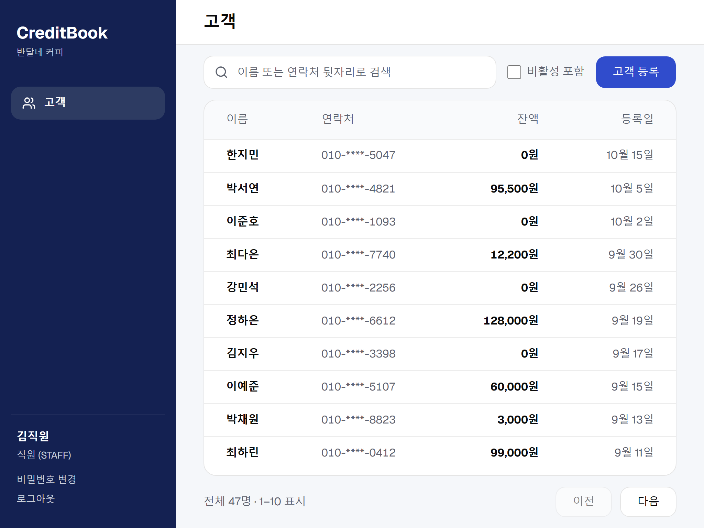
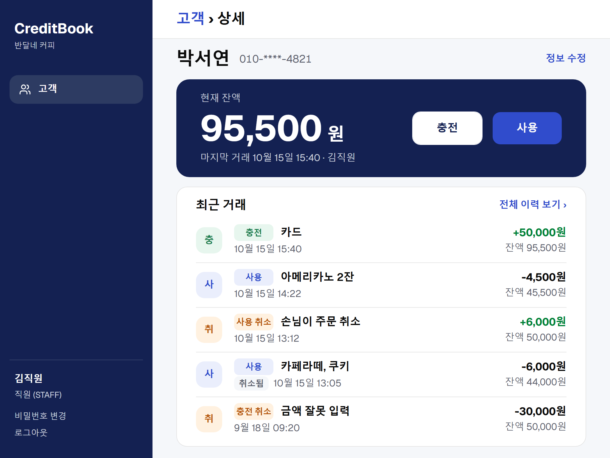
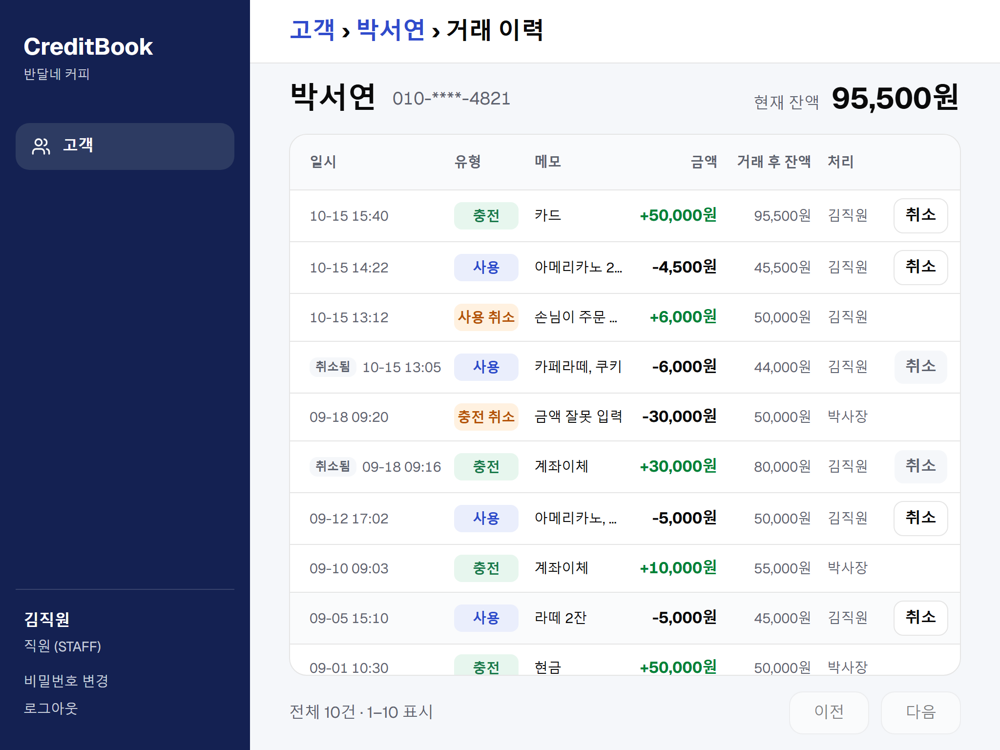
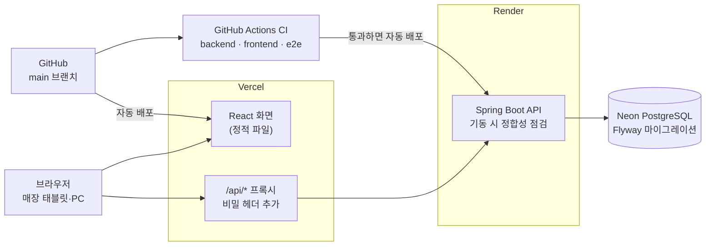

# CreditBook

카페·식당이 손님에게 미리 받은 선결제 금액을 기록하고 차감하는 **잔액 장부** 웹앱이다. 결제(PG)는 다루지 않는다 - 이미 받은 돈을 정확히 적고, 쓰고, 되돌리는 도구다.

이 프로젝트에서 중요한 것은 기능 수가 아니라 **잔액이 언제나 맞는다는 것(정합성)**과 **모든 변화를 거슬러 올라갈 수 있다는 것(추적 가능성)**이다. 설계와 테스트는 모두 이 두 가지를 증명하는 쪽으로 짰다.

- 1인 프로젝트, 8주(1주 스프린트 7회 + 쉬는 주 1주, 2026-09-21 ~ 11-15)
- 요구사항·화면설계·테스트 케이스·결정 기록은 Notion에서 관리하고, 테스트는 TC 번호 태그로 그 문서와 이어진다

| 고객 목록 | 고객 상세 |
|---|---|
|  |  |
| **충전 확인** | **거래 이력** |
| ![충전 확인 - 처리 전후 잔액을 보여 주고 [확인]을 눌러야 기록](docs/images/charge-confirm.png) |  |

<sub>스크린샷은 목 데이터 모드(가상 고객)에서 1024×768로 찍었다.</sub>

## 무엇을 하나

- **고객**: 등록(같은 번호면 확인 후 저장), 정보 수정(변경 기록, 동시 수정 방지), 비활성화(잔액 0원일 때만, 사장만). 연락처는 화면·응답 어디서나 가린 값만 보인다
- **충전·사용**: 입력 → 확인 두 단계. 1회 충전 한도, 잔액 부족 차단, 같은 요청을 두 번 보내도 한 번만 처리
- **취소**: 충전 취소(당일만)·사용 취소. 원래 거래를 고치지 않고 반대 거래를 하나 더 적는다
- **매장**: 초대 코드로 가입하면 새 매장과 그 매장 사장 계정이 생긴다. 사장은 직원 계정을 만들고 비밀번호를 초기화할 수 있다. 매장끼리 데이터가 섞이지 않는다
- **로그인**: 연속 5회 실패 시 5분 잠금, IP별 요청 횟수 제한, 직원은 첫 로그인 때 비밀번호 변경

## 잔액이 틀리지 않게 하는 방법

| 위험 | 막는 방법 |
|---|---|
| 기록된 거래를 누군가 고치거나 지운다 | 거래 표(`ledger_entries`)는 추가만 된다. 수정·삭제 API를 만들지 않았고, DB 트리거가 UPDATE·DELETE·TRUNCATE를 거절한다. 정정은 반대 거래(반제)로만 |
| 잔액 계산이 여러 곳에 흩어져 어긋난다 | 잔액을 더하고 빼는 계산과 검사는 도메인 객체 `PrepaidAccount` 한 곳에만 있다. 화면은 금액을 계산하지 않고 서버 값을 보여 준다 |
| 같은 계좌에 동시에 사용 요청이 들어온다 | 낙관적 락(버전)으로 늦은 쪽을 409로 거절한다 |
| 네트워크가 끊겨 같은 요청을 다시 보낸다 | 충전·사용·사용 취소는 요청 키(`Idempotency-Key`)가 필수다. 같은 키로 다시 오면 저장된 응답을 그대로 돌려준다 |
| 잔액과 거래 합계가 어긋난 채로 운영된다 | 서버가 뜰 때마다 정합성 점검 6개(잔액 = 거래 합계, 거래 후 잔액 누적, 반제 짝 등)를 읽기 전용으로 돌려 어긋나면 로그에 남긴다 |
| 다른 매장의 고객·거래가 섞인다 | 모든 표에 매장 구분 칸을 두고 (매장, id) 복합 외래 키로 다른 매장 행을 잇지 못하게 한다. 조회는 로그인한 직원의 매장으로만 |

## 테스트

- **정합성 증명 3종**
  - 대사: 시나리오를 돌린 뒤 정합성 점검 쿼리가 모두 0행
  - 동시성: 같은 계좌 동시 차감에서 초과분은 409, 최종 잔액 = 성공한 거래 합계
  - 추가만 되는 장부: 앱 계정으로 거래 UPDATE·DELETE를 시도하면 실패
- **단위 테스트**(JUnit 5): 도메인 규칙, 경계값은 `@ParameterizedTest`. 도메인 패키지 라인 커버리지 80% 미만이면 빌드 실패
- **통합 테스트**(Spring Boot + Testcontainers PostgreSQL): API·권한·요청 키·매장 간 격리. H2가 아니라 운영과 같은 PostgreSQL로 돈다. 모든 통합 테스트 옆에 이웃 매장을 두고, 테스트가 끝난 뒤 그 매장이 그대로인지 확인한다
- **E2E**(Playwright): 실제 백엔드에 붙어 주경로·모달·세션 복구·권한별 화면을 확인한다
- **추적**: TC를 검증하는 테스트에는 `@Tag("TC-n")`(E2E는 제목의 `@TC-n`)을 붙이고, TC 결과는 그 테스트의 main CI 결과로만 판정한다
- **보안 점검**: OWASP 기준으로 직접 요청을 보내 확인한 기록 - [docs/security-check.md](docs/security-check.md). 탐색적 테스트 기록 - [docs/exploratory-test-s5.md](docs/exploratory-test-s5.md)

## 구성



- 화면과 API는 같은 주소로 보이고, Vercel이 `/api/*`를 백엔드로 넘기며 비밀 헤더를 붙인다. 백엔드는 이 헤더가 없거나 다르면 403으로 거절한다(헬스 체크만 예외). 그래서 프록시가 넘긴 접속자 IP를 믿고 로그인 요청 횟수를 셀 수 있다
- `main`은 브랜치 보호로 PR + CI 통과로만 바뀐다. 마이그레이션은 백엔드가 뜰 때 적용되므로, 스키마 변경은 복구 지점을 만들고 롤백 리허설을 거친 뒤 병합한다

| 영역 | 사용 |
|---|---|
| 백엔드 | Java 17, Spring Boot 4.0, Spring Security, Spring Data JPA, Flyway, DDD 구조(도메인 최상위 패키지) |
| 화면 | React 19, TypeScript, Vite, Tailwind CSS 4, shadcn/ui |
| DB | PostgreSQL (Neon) |
| 테스트 | JUnit 5, Testcontainers, JaCoCo, Playwright |
| 배포·CI | Vercel, Render(Docker), GitHub Actions |

## 실행

필요한 것: Java 17, Docker Desktop, Node.js 22 최신

```bash
# 1. 로컬 DB (리포 루트)
docker compose up -d

# 2. 백엔드 (backend/) - 로그인 서명 키 환경변수 CREDITBOOK_JWT_SECRET 필요
./gradlew bootRun          # http://localhost:8080
./gradlew build            # 전체 테스트 (Docker 켜져 있어야 함)

# 3. 화면 (frontend/)
npm ci
npm run dev                # http://localhost:5173, 기본은 목 데이터
```

- 백엔드는 기본으로 로컬 Docker DB에 붙는다. 서명 키 만들기, 개발용 직원 넣기, 프로필 구분은 [docs/dev-environment-guide.md](docs/dev-environment-guide.md)
- 화면만 보고 싶으면 백엔드 없이 `npm run dev`(목 데이터)로 충분하다. 목 데이터·실제 API 전환과 E2E 실행은 [frontend/README.md](frontend/README.md)

## 데모

배포본의 장부는 실제 장부라 거래를 지울 수 없다. 그래서 공개 주소와 공용 체험 계정을 두지 않는다.

- 확인이 필요하면 요청한 분께 배포 주소와 **가입 1회용 초대 코드**를 따로 전달한다. 그 코드로 가입하면 빈 매장과 그 매장의 사장 계정이 생겨, 고객 등록부터 충전·사용·취소까지 직접 해 볼 수 있다
- 확인이 끝나면 그 초대 코드를 사용 중지한다. 초대 코드는 공개 문서에 적지 않는다
- 서버 없이 화면만 보려면 위 실행 방법의 목 데이터 모드를 쓴다

## 리포 구조

```
backend/    Spring Boot API (customer · prepaid · auth · store · global)
frontend/   React 화면, e2e/ 에 Playwright 테스트
docs/       개발 환경 안내, 보안 점검·탐색적 테스트 기록, API 명세와 구현 차이 목록
.github/    CI 워크플로
```
